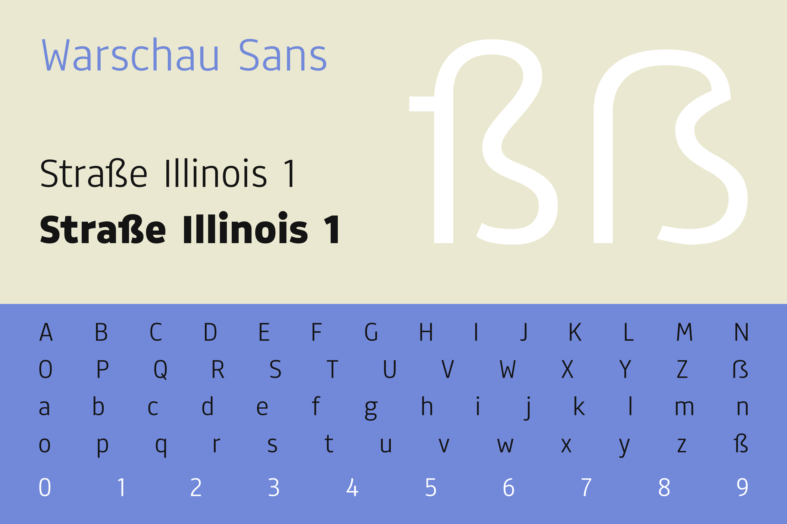
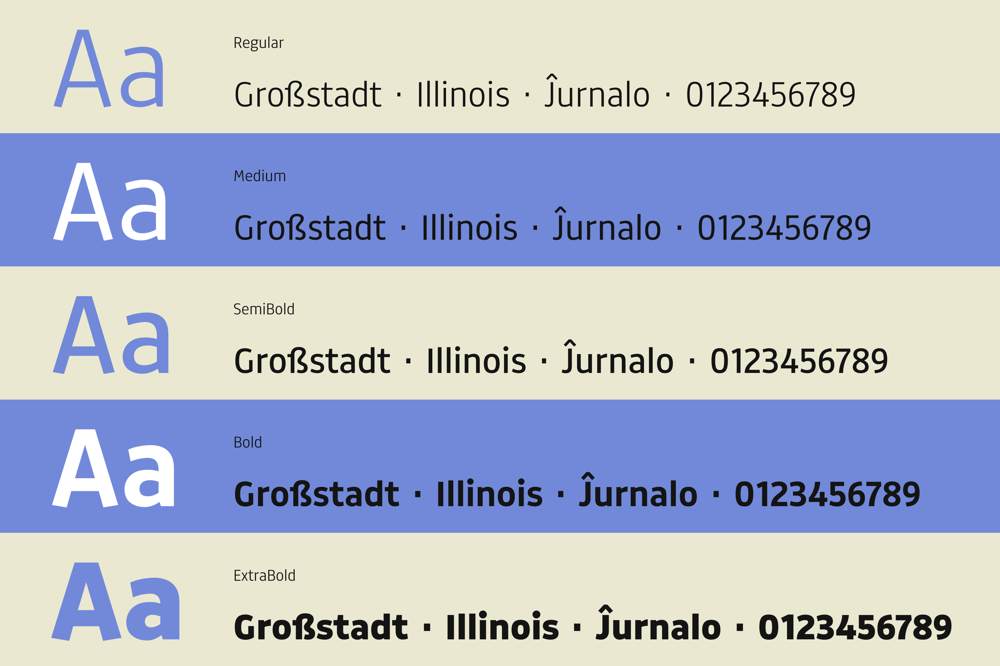
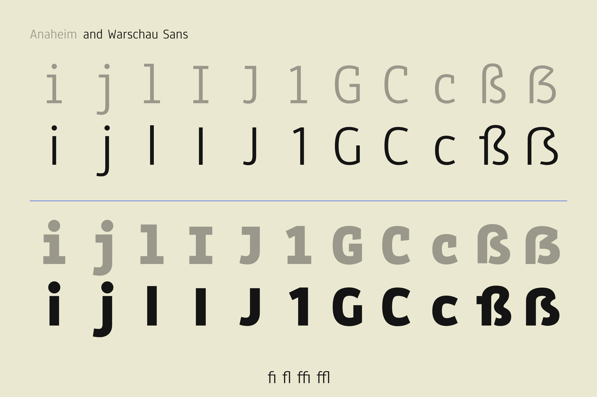
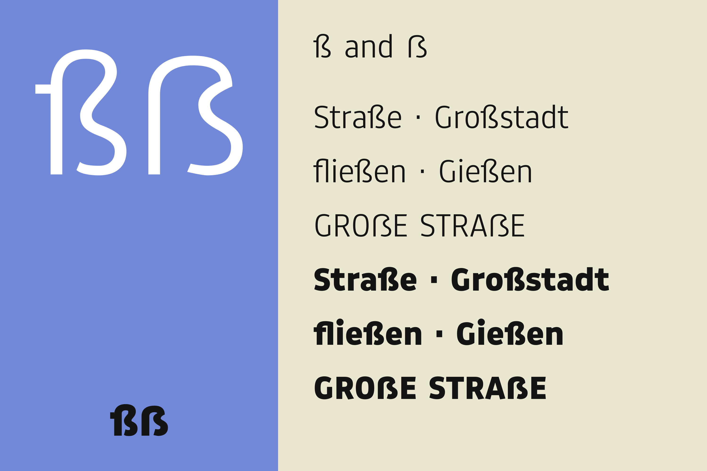
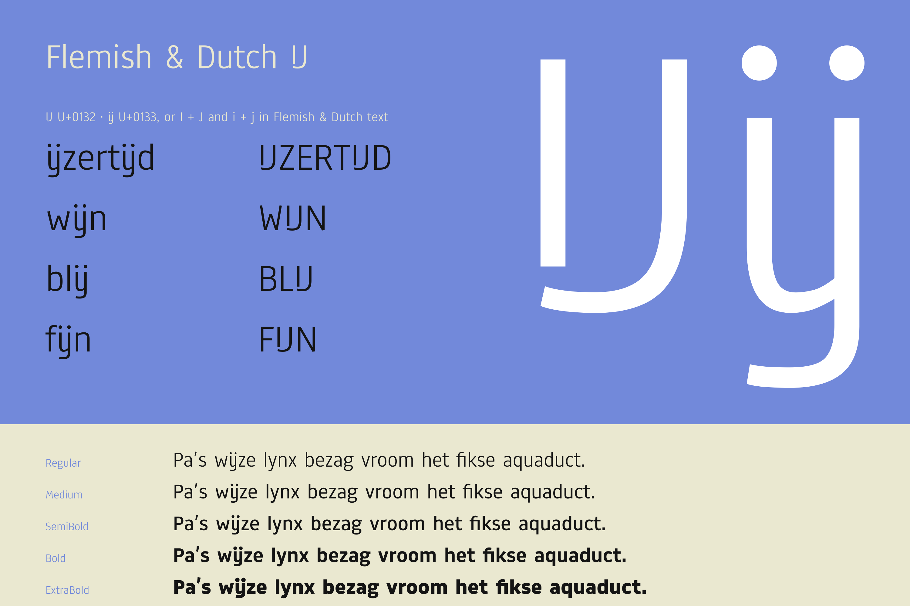
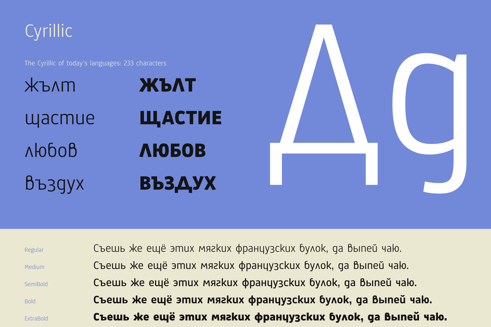
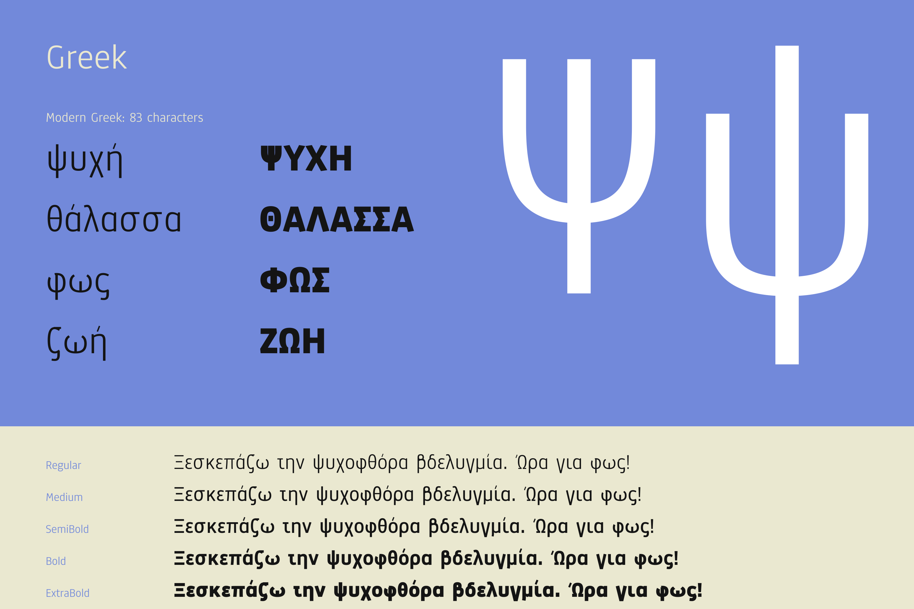
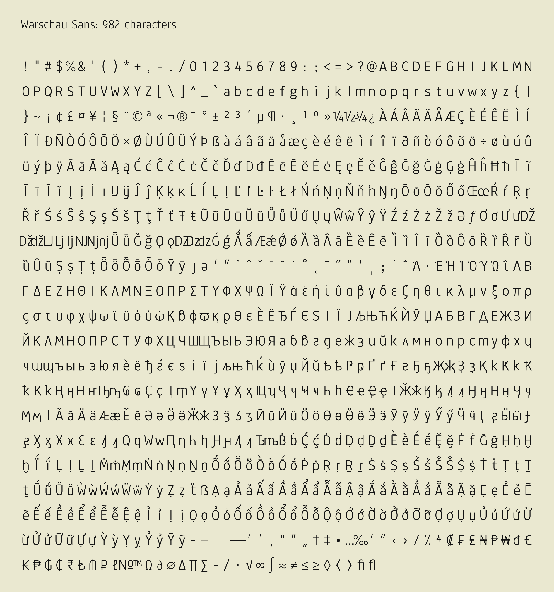

# Warschau Sans

A sans serif forked from **Anaheim 2.001** by Vernon Adams, with:

- **no slab serifs or spurs**: i, j, l, I and J are plain stems, the 1 keeps its flag but loses its foot, and G, C
  and c end their arcs without a spur (G also without its bar)
- a redesigned **ß** with the stub of a long s, and a **ẞ** to match
- **Flemish & Dutch IJ ij**, with i + j joining automatically in Flemish & Dutch text
- **Cyrillic**, for the languages written in it today, and modern **Greek**

The rest of the Latin is Anaheim's, and the Cyrillic and Greek are drawn from its letters. Five weights, from
Regular to ExtraBold, as one variable font and as static fonts.



## What changed

Each change follows Anaheim's own rules: the plain stems take its stem spacing, the spurless arcs end the way its ₵,
€ and ₲ already do, dots and accents sit on the new stems, and the kerning before j keeps every letter clear of
the j's longer hook. The [design notes](https://github.com/crweul/warschau-sans-src/blob/main/docs/design-notes.md)
explain each one.



## ß and ẞ

The small eszett rises from the stem of a long s, stub included, and turns through a waist into the lower bowl of
an s; the capital follows it with a sharper bend. Both are drawn with Anaheim's stroke weights and curves.



## Flemish & Dutch IJ

Typed i + j joins into ij in Flemish & Dutch text, and the IJ and ij characters always use this design.



## Cyrillic

233 characters, for the languages written in Cyrillic today, from Russian, Ukrainian, Belarusian, Bulgarian,
Serbian and Macedonian to Kazakh, Kyrgyz, Tajik, Tatar, Bashkir, Chuvash, Abkhaz, Mongolian, Khanty and Nenets.
The lowercase has one set of forms: д with a round bowl and a descending hook, в with a closed loop, г as a
mirrored s, л as ʌ, и й п т as u ŭ n m, and ж and ю with tall stems; Л is Λ, and Д stands on a base. Every letter
is built from Anaheim's own strokes, bowls and curves.



## Greek

83 characters: modern (monotonic) Greek, with the letter variants used in mathematics. The tonos stands over the
lowercase and in front of the capitals, and text typed with combining accents composes to the accented letters.



## Character set

982 characters: Latin and extended Latin, including Vietnamese, Cyrillic and Greek, with figures and symbols.



## Use

Fonts are in [`fonts/variable`](fonts/variable) (one variable font, weights 400 to 800),
[`fonts/ttf`](fonts/ttf) (Regular, Medium, SemiBold, Bold, ExtraBold) and [`fonts/webfonts`](fonts/webfonts)
(WOFF2).

```css
@font-face {
  font-family: "Warschau Sans";
  src: url("WarschauSans[wght].woff2") format("woff2");
  font-weight: 400 800;
  font-style: normal;
}
```

- **Flemish & Dutch:** set `lang="nl-BE"` or `lang="nl"` and typed i + j becomes ij, and í j́ becomes ij with two
  acutes. Loanwords such as *Beijing*, *Fiji* or *hijab*, and compounds such as *minijurk*, stay as two letters. To
  keep any other word apart, put `&zwnj;` between the i and the j. The IJ and ij characters (U+0132, U+0133) always
  use the new design.

## License

[SIL Open Font License 1.1](LICENSE), with Reserved Font Name "Warschau Sans". The fonts are free to use,
including on websites and in apps. Modified versions must stay under the same license and may not use the name
Warschau Sans.
